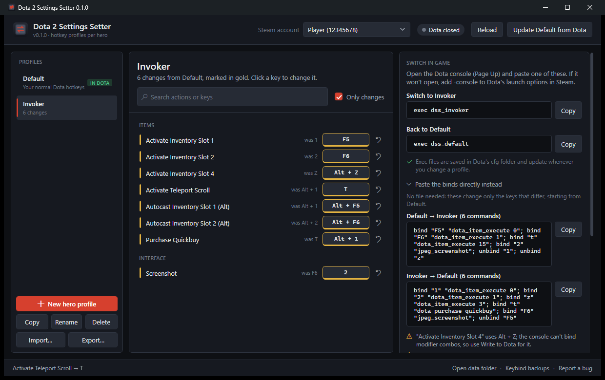

# Dota 2 Settings Setter
Made with love by TheDucktator, Rare (Avi-From-Polysights) and AI. Mostly AI. A little bit of love though.

A small Windows app that keeps a separate Dota 2 hotkey setup for each hero and switches between them in seconds.

Dota's own per-hero hotkeys only cover the six ability slots. This covers everything else as well: item slots, TP, neutral item, quickcast and autocast keys, unit actions, control groups, camera and chat wheel.



## Download

Grab **`Dota2SettingsSetter.exe`** from the [latest release](https://github.com/Avi-From-Polysights/Dota2SettingsSetter/releases/latest) and run it. There is no installer.

- Windows 10 or 11. It runs on .NET Framework 4.8, which Windows already includes.
- The exe isn't code-signed, so Windows SmartScreen may warn on first launch. Click **More info → Run anyway**.

## How to use

1. **Open the app.** It finds Steam and your Dota hotkeys and saves them as **Default**.
2. **Click New hero profile** and name it after the hero, e.g. `Invoker`.
3. **Click any key to change it.** If the new key is already taken, pick Swap, Unbind it or Keep both. Changed keys turn gold; the ↺ button puts one back.
4. **Switch.** There are two ways (see the table below):
   - **In game:** open the console and type `exec dss_invoker`. To go back, type `exec dss_default`.
   - **By keybind file:** close Dota, click **Write Invoker to Dota**, then start Dota. Click **Restore Default** when you're done.

### Turning on the console

In Steam: right-click **Dota 2 → Properties → Launch Options** and add `-console`. The app shows your console hotkey (Dota's default is `\`).

## In game vs. keybind file

| | In game (console) | Keybind file |
| --- | --- | --- |
| When | Any time, even mid-match | Dota closed; applies next launch |
| What it switches | Plain keys | Everything, including Alt/Ctrl/Shift combos |
| How | `exec dss_<profile>`, or paste the bind commands shown in the app | One click |
| Catch | A key also set in Dota's own hotkey menu can win over the console bind | Needs a Dota restart |

The in-game command only changes the keys that actually differ, so it stays short. The `exec` files are rebuilt every time you edit a profile. Each one sets every key any of your profiles touches, so it works no matter which profile was active before.

## Is it safe?

The app never touches the running game. It only does what you could do by hand:

- It edits Dota's own hotkey file, `Steam\userdata\<id>\570\remote\cfg\dotakeys_personal.lst`, and only while Dota is closed.
- It writes `.cfg` files into `dota 2 beta\game\dota\cfg` for Dota's built-in `exec` command.

Before every write it backs up Dota's hotkey file, keeping the last 20 copies. It only changes the hotkey entries your profiles use. Per-hero bindings, item cast modes, hero builds and everything else in the file stay exactly as they were.

There are no network calls. Your profiles live in `%APPDATA%\Dota2SettingsSetter\accounts\<steam id>\`.

## Known limits (v0.1.0)

- **In-game switching still needs QA.** How Dota resolves a console bind against a key set in its hotkey menu hasn't been tested in a match yet. See the [QA issue](https://github.com/Avi-From-Polysights/Dota2SettingsSetter/issues?q=is%3Aissue+label%3Aqa).
- **No modifier combos in game.** The console can't bind Alt/Ctrl/Shift combos, so the app warns and points you to the keybind file for those.
- **Hotkeys only.** Other settings (quickcast options, camera speed and so on) aren't covered yet.
- **Unknown defaults count as unbound.** Hotkeys Dota has never written into your file are treated as unbound.
- **Re-capture after in-game changes.** If you change hotkeys inside Dota, the app shows a banner. Press **Update Default from Dota** so Default matches again.

## Reporting bugs and feedback

[Open an issue](https://github.com/Avi-From-Polysights/Dota2SettingsSetter/issues/new/choose) and include:

- The app version (title bar)
- Which switch method you used
- What you typed or pasted into the console

If the app hit an error, also attach `%APPDATA%\Dota2SettingsSetter\error.log`.

## Building from source

You need Windows and the [.NET SDK](https://dotnet.microsoft.com/download) 8 or newer.

```bash
dotnet test
dotnet build src/Dota2SettingsSetter -c Release
# -> src/Dota2SettingsSetter/bin/Release/net48/Dota2SettingsSetter.exe
```

To try the app without touching your real Dota files, point it at copies:

```powershell
$env:D2SS_STEAM_DIR = "C:\temp\fake-steam"   # needs userdata\<id>\570\remote\cfg\dotakeys_personal.lst
$env:D2SS_DATA_DIR  = "C:\temp\d2ss-data"
.\src\Dota2SettingsSetter\bin\Debug\net48\Dota2SettingsSetter.exe
```

Pushing a `v*` tag builds and publishes a GitHub release with the exe attached (see `.github/workflows/release.yml`).

## Contributing

Contributions are welcome. Please read [CONTRIBUTING.md](CONTRIBUTING.md). Fork the repo and open a PR; **only the maintainer can approve and merge** pull requests.

## License

MIT; see [LICENSE](LICENSE).
